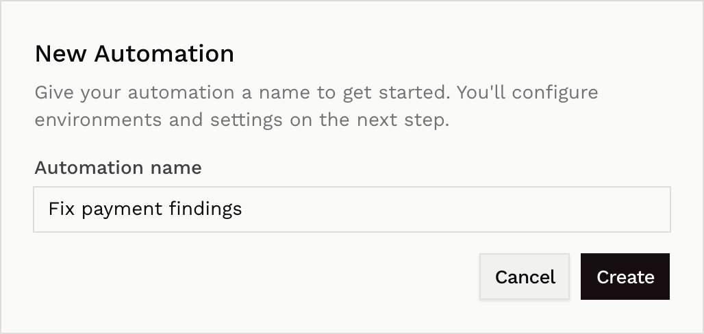
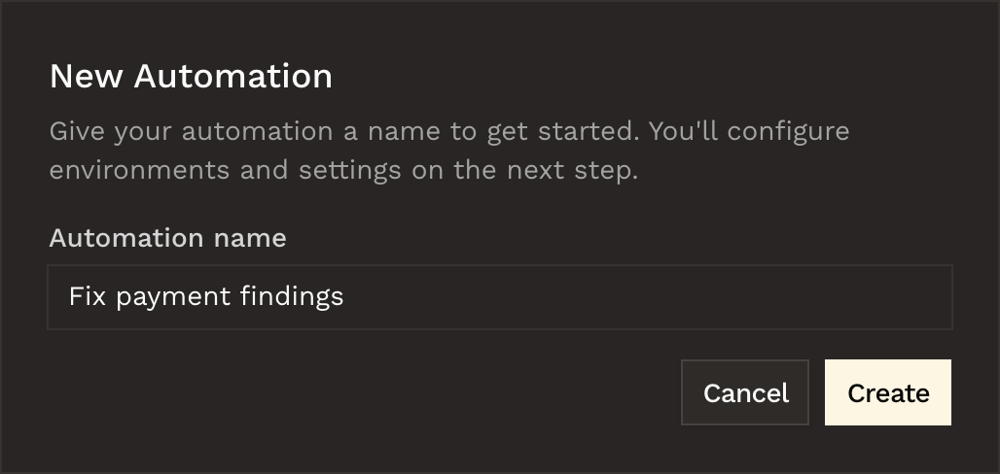
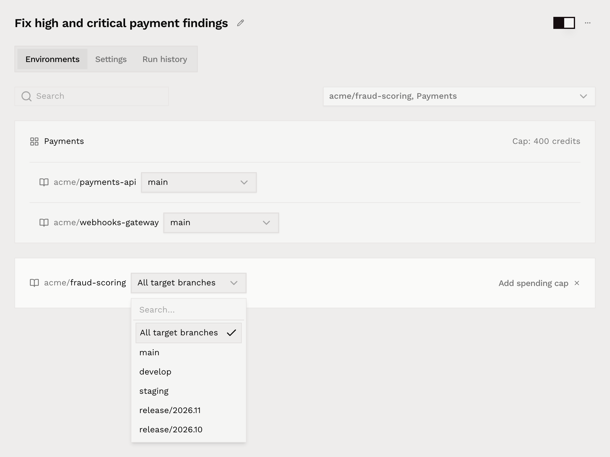
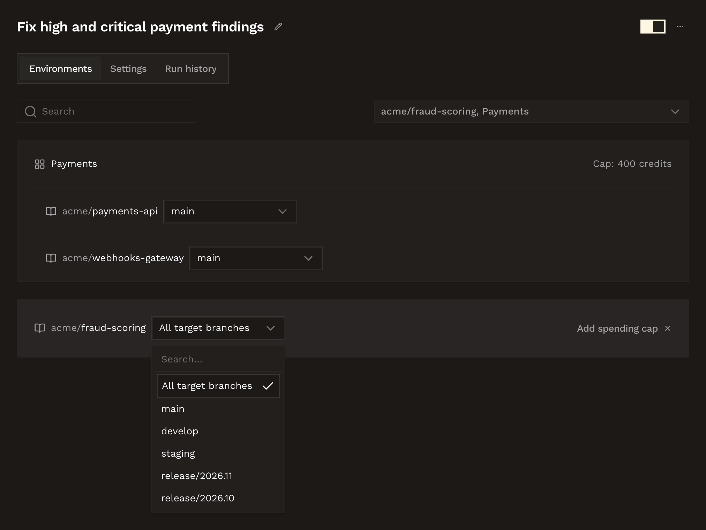
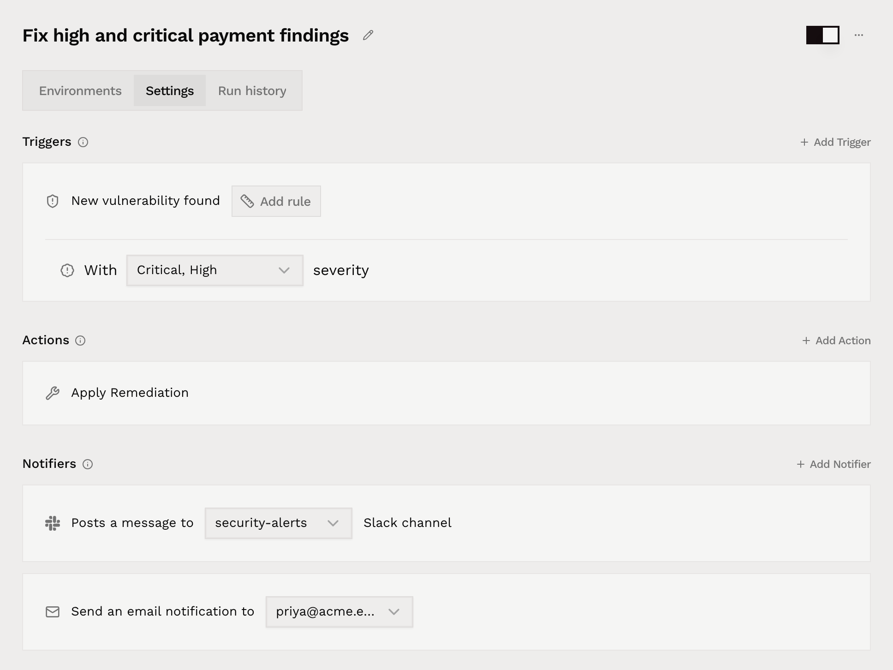
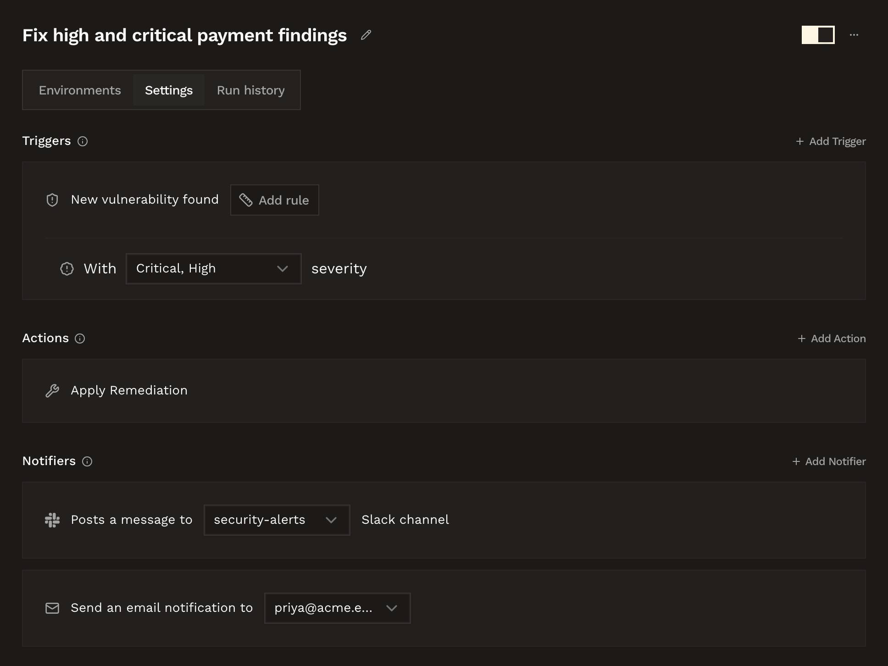
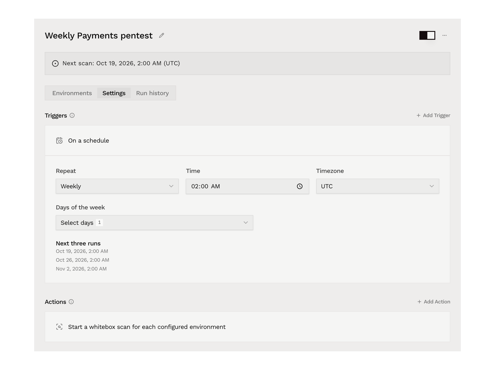
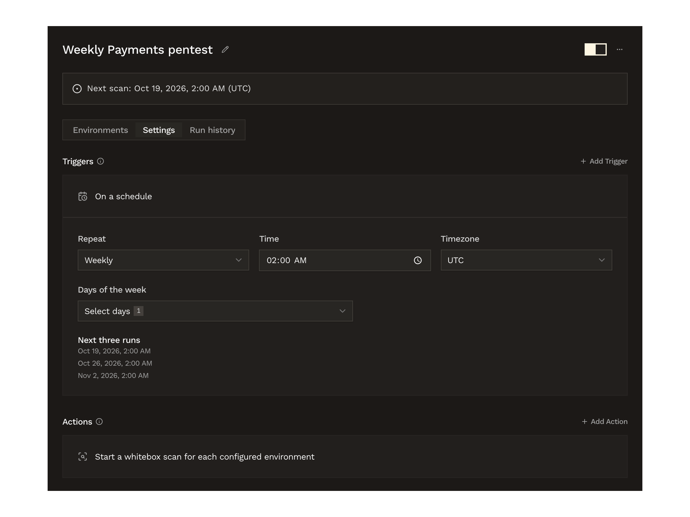
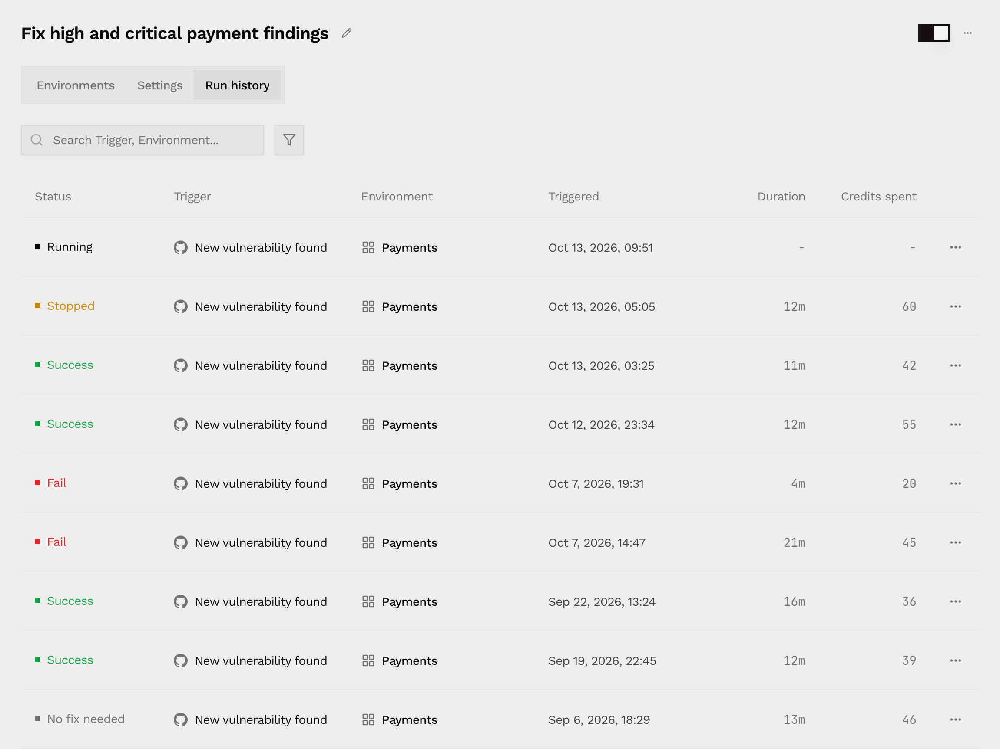
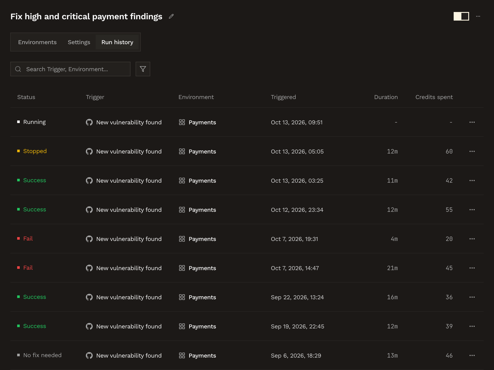

An automation acts for you. It has one trigger: **New vulnerability found**, for new findings that match the rules you set, or **On a schedule**, for the times you set. When the trigger fires, Hacktron runs the automation's **action**.

<Tip>
  Each trigger has its own action. **New vulnerability found** runs **Apply
  Remediation**, which starts a [remediation](/platform/automations/remediation)
  run that fixes the finding. **On a schedule** runs **Start whitebox scan**,
  which starts a [scheduled whitebox scan](#scheduled-whitebox-scans) of each
  environment.
</Tip>

Automations are under **Automations** in the dashboard sidebar. Organization **Admins** create and manage them, and other members can view them.

## Create an automation

<Steps>
  <Step title="Create">
    On the **Automations** page, select **New automation** and give it a name.

    

  <Frame>
    
  </Frame>

  <Frame>
    
  </Frame>

  </Step>
  <Step title="Pick environments">
    Choose the repositories and [applications](/platform/context/applications) the automation covers. You can limit each entry to specific branches, up to two, or leave the branch selection empty to cover all branches. A scheduled automation takes its branches from each environment's [scan settings](#scheduled-whitebox-scans) instead.

    

  <Frame>
    
  </Frame>

  <Frame>
    
  </Frame>

  </Step>
  <Step title="Configure settings">
    On the **Settings** tab, set:

    | Setting | What it sets |
    | --- | --- |
    | **Triggers** | When the automation runs, added from **Add Trigger**. An automation has one trigger. **New vulnerability found** fires on a new finding, and **Add rule** limits it to the severity levels that qualify. **On a schedule** fires at the times you [set](#scheduled-whitebox-scans). |
    | **Actions** | What the automation does, added from **Add Action**. **Apply Remediation** starts a [remediation](/platform/automations/remediation) run for the matching finding. **Start whitebox scan** is only available with **On a schedule**, and **Apply Remediation** isn't available with it. |
    | **Notifiers** | Who hears about a run: a Slack channel, email recipients from your organization's members, or both. |

    

  <Frame>
    
  </Frame>

  <Frame>
    
  </Frame>

  </Step>
  <Step title="Save">
    Select **Save changes**. An automation needs at least one environment, one trigger, and one action to run, and a scheduled automation also needs scan settings for every environment. An incomplete automation shows an **Incomplete** badge and can't be enabled. A save that removes required configuration disables the automation until it is complete again.
  </Step>
</Steps>

## When an automation fires

An automation with **New vulnerability found** fires when a new finding matches its severity rule and environment, including any branch limits, and the automation is enabled. **Apply Remediation** then starts a remediation run, which uses [automation credits](/platform/automations/credits). After the action, Hacktron sends a notification.

Each finding is fixed at most once. A finding that already has a remediation run doesn't fire automations again.

### Notifications

In Slack, Hacktron posts a message to your channel with a link to the finding. The Hacktron bot joins public channels on its own. For a private channel, invite the bot first.

By email, Hacktron writes to the recipients you chose from your organization's members.

Notifications are best-effort. If one fails to send, the remediation run goes ahead.

## Scheduled whitebox scans

An automation with **On a schedule** runs a whitebox scan of each of its environments at the times you set. Adding the trigger sets the action to **Start whitebox scan**, which the **Settings** tab shows as **Start a whitebox scan for each configured environment**. Removing the trigger removes that action too.

<Steps>
  <Step title="Set the schedule">
    On the **Settings** tab, select **Add Trigger**, then **On a schedule**. A new schedule repeats weekly on Monday at 02:00, in your browser's timezone. Change it with these fields:

    | Field | What it sets |
    | --- | --- |
    | **Repeat** | **Daily**, **Weekly**, **Monthly**, or **Custom cron**. |
    | **Time** | The time of day the scan starts. With **Custom cron**, the expression sets the time instead. |
    | **Timezone** | The timezone the schedule follows, such as `UTC` or `Europe/London`. |
    | **Days of the week** | With **Weekly**, the days to scan. |
    | **Day of the month** | With **Monthly**, a day from 1 to 31. Months without that date are skipped. |
    | **Cron expression** | With **Custom cron**, five fields: minute, hour, day of month, month, and day of week, in the selected timezone. |

    **Next three runs** lists the next three scan times, so you can check the schedule before you save it. A cron expression needs five fields and at least one future run. For quarterly scans at 02:00 on 1 January, 1 April, 1 July, and 1 October, use `0 2 1 1,4,7,10 *`.

    

  <Frame>
    
  </Frame>

  <Frame>
    
  </Frame>

    Select **Save changes**.

  </Step>
  <Step title="Set up the scan for each environment">
    On the **Environments** tab, each environment now has **Set up scan** in place of the branch picker. Select it to open the environment's scan settings. They reuse the steps of the [Whitebox Scans wizard](/white-box-pentest/quickstart), with **Scan options** in place of the cost calculation and checkout:

    | Step | What it sets |
    | --- | --- |
    | **Select source** | The repositories to scan and the revision of each. For an application, these are its repositories. A branch uses its latest revision on each run. |
    | **Scope** | Optional. The [paths to include and exclude](/white-box-pentest/quickstart#path-patterns) in each repository. |
    | **Define targets** | Optional. The applications to test dynamically, with the login instructions for each. |
    | **Context documents** | Optional. Documents that explain the application, and **Additional scan instructions**. |
    | **Scan options** | **Model tier** (**Default** or **Legacy**) and **Max whitebox credits per scan**, a whole number from 1 to 1,000,000. |
    | **Review details** | A summary of the other steps. |

    Select **Save scan settings**. Changes apply to future scans, and scans that have already started keep their settings. The environment's button then reads **Edit scan settings**. Only organization **Admins** can edit scan settings and login instructions.

  </Step>
  <Step title="Turn the automation on">
    A scheduled automation can't be turned on until every environment has scan settings, and saving the schedule doesn't turn it on. Use the switch next to the automation's name. Once it's on, the automation's page shows the date and timezone of the next scan.

    Adding an environment without scan settings turns the automation off until you set up that environment's scan.

  </Step>
</Steps>

### Login checks

Saved login instructions are checked before every scan. If the login fails, that scan doesn't start. To check them straight away, select **Save and check login** on the last step of the scan settings. The result shows on the **Define targets** and **Review details** steps, and the check appears in the [run history](#run-history) as **Login check**.

If authenticated testing isn't enabled for your organization, Hacktron keeps the login instructions, but scans that need them can't start until it's enabled.

### Credits and skipped scans

Scheduled scans spend the organization's [Whitebox Scan credits](/white-box-pentest/billing). Each scan gets a fresh cost estimate. **Max whitebox credits per scan** includes the scan and any human triage it needs. A scan above that limit, or one the balance can't cover, doesn't start, and its run shows **Needs attention** with the reason. If the previous scan for an environment is still in progress when the next one is due, the next one is skipped. Missed scans are skipped too.

## Run history

The **Run history** tab lists every run the automation has fired, with its status, the environment it matched, and the credits it used. A run matched through an application is attributed to that application.

Run statuses follow the [remediation outcomes](/platform/automations/remediation#outcomes): **Running**, **Success**, **No fix needed**, **False positive**, **Fail**, and **Stopped**. You can filter the history by status and search it.

A scheduled scan's run opens the scan it started. While the scan is running, its row shows the stage: **Queued**, **Checking login**, **Estimating scope**, **Starting scan**, or **Scanning**. Scheduled runs can also end as **Needs attention** or **Skipped**. When a run records a reason, it shows under the status.

  <Frame>
    
  </Frame>

  <Frame>
    
  </Frame>

## Related docs

<Columns cols={2}>
  <Card
    title="Remediation"
    icon="wrench"
    href="/platform/automations/remediation"
  >
    How a remediation run works and where the fix lands.
  </Card>
  <Card
    title="Automation credits"
    icon="coins"
    href="/platform/automations/credits"
  >
    How remediation runs are billed and how auto top-up works.
  </Card>
</Columns>
