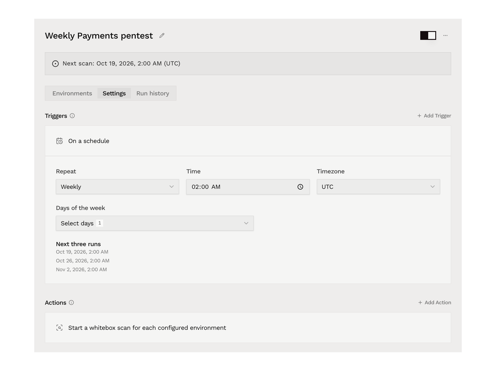
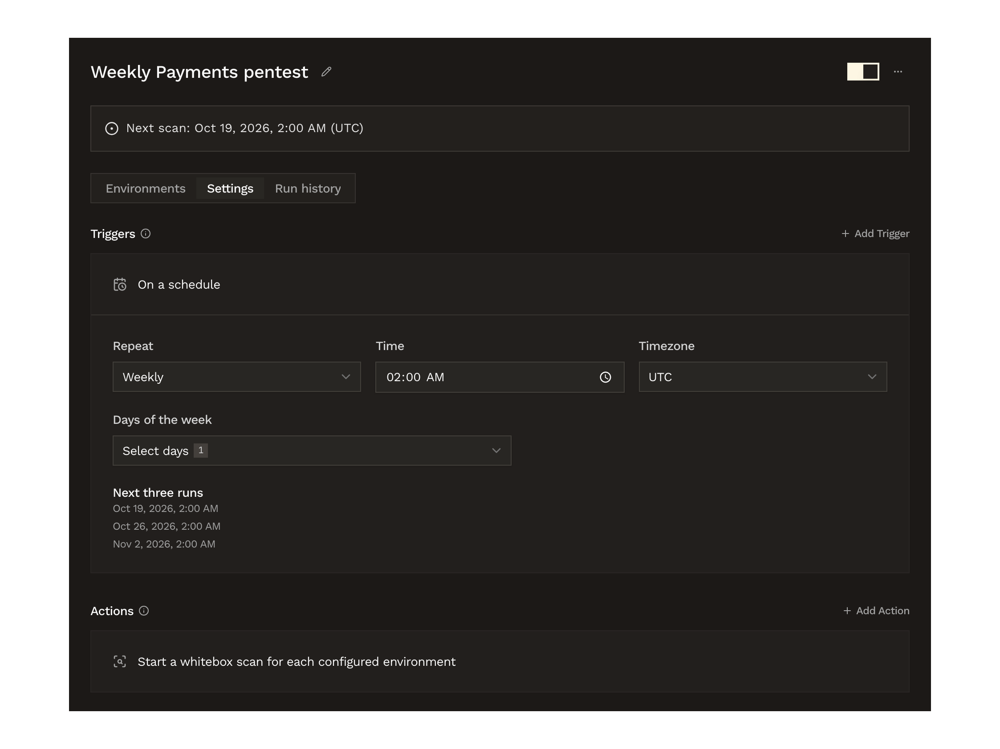

[Automations](/platform/automations/overview) can run whitebox scans on a schedule. Each environment has saved scan settings for its repositories, scope, targets, and credit limit.

Organization **Admins** create and manage scheduled scans. Runs spend the organization's [Whitebox Scan credits](/white-box-pentest/billing).

## Create a scheduled scan

On **Automations**, select **New automation**, give it a name, and add the repositories or [applications](/platform/context/applications) to scan on the **Environments** tab.

An automation with **On a schedule** runs a whitebox scan of each of its environments at the times you set. Adding the trigger sets the action to **Start whitebox scan**, which the **Settings** tab shows as **Start a whitebox scan for each configured environment**. Removing the trigger removes that action too.

<Steps>
  <Step title="Set the schedule">
    On the **Settings** tab, select **Add Trigger**, then **On a schedule**. A new schedule repeats weekly on Monday at 02:00, in your browser's timezone. Change it with these fields:

    | Field | What it sets |
    | --- | --- |
    | **Repeat** | **Daily**, **Weekly**, **Monthly**, or **Custom cron**. |
    | **Time** | The time of day the scan starts. With **Custom cron**, the expression sets the time instead. |
    | **Timezone** | The timezone the schedule follows, such as `UTC` or `Europe/London`. |
    | **Days of the week** | With **Weekly**, the days to scan. |
    | **Day of the month** | With **Monthly**, a day from 1 to 31. Months without that date are skipped. |
    | **Cron expression** | With **Custom cron**, five fields: minute, hour, day of month, month, and day of week, in the selected timezone. |

    **Next three runs** lists the next three scan times, so you can check the schedule before you save it. A cron expression needs five fields and at least one future run. For quarterly scans at 02:00 on 1 January, 1 April, 1 July, and 1 October, use `0 2 1 1,4,7,10 *`.

    

  <Frame>
    
  </Frame>

  <Frame>
    
  </Frame>

    Select **Save changes**.

  </Step>
  <Step title="Set up the scan for each environment">
    On the **Environments** tab, each environment now has **Set up scan** in place of the branch picker. Select it to open the environment's scan settings. They reuse the steps of the [Whitebox Scans wizard](/white-box-pentest/quickstart), with **Scan options** in place of the cost calculation and checkout:

    | Step | What it sets |
    | --- | --- |
    | **Select source** | The repositories to scan and the revision of each. For an application, these are its repositories. A branch uses its latest revision on each run. |
    | **Scope** | Optional. The [paths to include and exclude](/white-box-pentest/quickstart#path-patterns) in each repository. |
    | **Define targets** | Optional. The applications to test dynamically, with the login instructions for each. |
    | **Context documents** | Optional. Documents that explain the application, and **Additional scan instructions**. |
    | **Scan options** | **Model tier** (**Default** or **Legacy**) and **Max whitebox credits per scan**, a whole number from 1 to 1,000,000. |
    | **Review details** | A summary of the other steps. |

    Select **Save scan settings**. Changes apply to future scans, and scans that have already started keep their settings. The environment's button then reads **Edit scan settings**. Only organization **Admins** can edit scan settings and login instructions.

  </Step>
  <Step title="Turn the automation on">
    A scheduled automation can't be turned on until every environment has scan settings, and saving the schedule doesn't turn it on. Use the switch next to the automation's name. Once it's on, the automation's page shows the date and timezone of the next scan.

    Adding an environment without scan settings turns the automation off until you set up that environment's scan.

  </Step>
</Steps>

## Login checks

Saved login instructions are checked before every scan. If the login fails, that scan doesn't start. To check them straight away, select **Save and check login** on the last step of the scan settings. The result shows on the **Define targets** and **Review details** steps, and the check appears in the [run history](#run-history) as **Login check**.

If authenticated testing isn't enabled for your organization, Hacktron keeps the login instructions, but scans that need them can't start until it's enabled.

## Credits and skipped scans

Scheduled scans spend the organization's [Whitebox Scan credits](/white-box-pentest/billing). Each scan gets a fresh cost estimate. **Max whitebox credits per scan** includes the scan and any human triage it needs. A scan above that limit, or one the balance can't cover, doesn't start, and its run shows **Needs attention** with the reason. If the previous scan for an environment is still in progress when the next one is due, the next one is skipped. Missed scans are skipped too.

## Run history

Open the automation's **Run history** tab to see its runs, matched environments, status, and credits used. A scheduled scan's run opens the scan it started.

While the scan is running, its row shows the stage: **Queued**, **Checking login**, **Estimating scope**, **Starting scan**, or **Scanning**. Scheduled runs can also end as **Needs attention** or **Skipped**. When a run records a reason, it shows under the status.

## Related docs

<Columns cols={2}>
  <Card title="Automations" icon="bolt" href="/platform/automations/overview">
    Configure triggers, actions, environments, and notifications.
  </Card>
  <Card
    title="Credits and billing"
    icon="credit-card"
    href="/white-box-pentest/billing"
  >
    Check the Whitebox Scan balance and buy credits.
  </Card>
</Columns>
