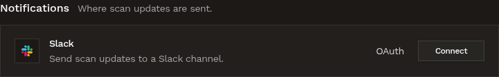
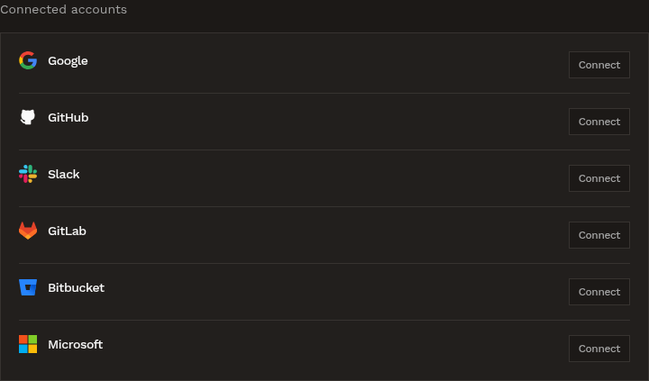
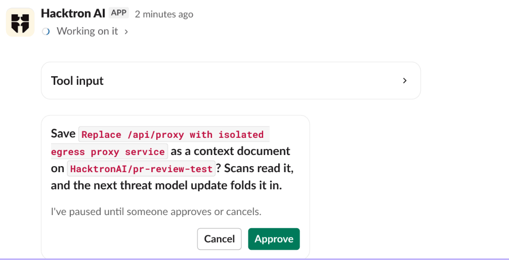
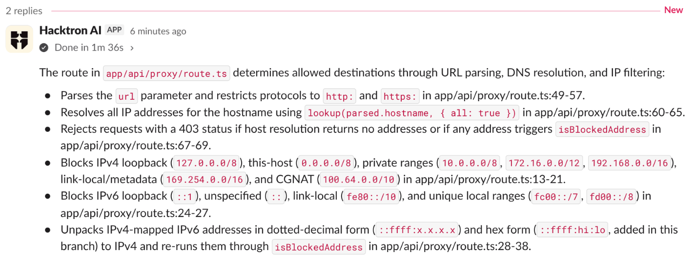

Mention **@Hacktron AI** in a Slack channel or direct message to ask security questions about your code and plans, check whether a vulnerability affects your repositories, work with your findings, set up a pentest or manage PR reviews. The assistant uses your Hacktron account and permissions, and replies in a thread.

You can continue in that thread without mentioning it again. Teammates can join by mentioning @Hacktron AI. Each person's requests use their own account and permissions.

## What you can ask it to do

| Task                                                                      | Example request                                                                               |
| ------------------------------------------------------------------------- | --------------------------------------------------------------------------------------------- |
| [Ask a security question](#ask-security-questions)                        | We're adding file uploads to acme/web. What should we think about?                            |
| [Check a vulnerability](#check-a-vulnerability-against-your-repositories) | Does CVE-2025-29927 affect any of our repositories?                                           |
| [Look into findings](#ask-about-findings)                                 | How many critical findings are open in acme/api?                                              |
| [Triage a finding](#act-on-findings-and-scans)                            | Mark the SSRF finding in acme/api as a false positive because the URL is allowlisted          |
| [Update your threat model](#keep-your-threat-model-up-to-date)            | Save our decision to fetch link previews through the egress proxy and update the threat model |
| [Set up a pentest](#set-up-a-pentest)                                     | Pentest acme/api on main and test staging.acme.com signed in                                  |
| [Manage PR reviews](#manage-pr-reviews)                                   | Turn on PR reviews for acme/api and acme/web                                                  |
| [Ask how Hacktron works](#ask-how-hacktron-works)                         | How do I stop reviews of PRs into release branches?                                           |

Reading never needs approval. Before Hacktron changes anything, it asks you to approve it in the thread. See [When Hacktron asks you to approve](#when-hacktron-asks-you-to-approve).

## Set up

<Steps>
  <Step title="Connect your workspace (organization admins)">
    In Hacktron, go to **Integrations** and find **Slack** under
    **Notifications**. Click **Connect**, then **Connect Slack** in the panel
    that opens. Approve the Hacktron AI app for your workspace to install it.
    See
    [Slack](/platform/communication-apps/slack) for the full steps.

    

    <Note>
      If Slack is already connected but Hacktron can't read attached archives,
      disconnect Slack and connect it again from **Integrations** to grant
      file access.
    </Note>

  </Step>
  <Step title="Link your Slack account">
    In Hacktron, open **Personal settings**, find **Connected accounts** and click
    **Connect** next to **Slack**. Choose the workspace connected to your
    organization so Hacktron can match your Slack and Hacktron accounts. See [Link your Slack
    identity](/code-review/integrations/slack#link-your-slack-identity).

    

  </Step>
  <Step title="Add Hacktron AI to a channel">
    In Slack, open the channel and send `/invite @Hacktron AI`. You can also
    click the channel name, open **Integrations** and click **Add apps**. This
    works for public and private channels.

    To send a direct message, find **Hacktron AI** under **Apps** in
    the Slack sidebar and send it a message.

  </Step>
  <Step title="Send your first request">
    Mention **@Hacktron AI** with a request. The first time, Hacktron sends
    you a private **Connect Hacktron** message. Click the button, sign in to
    Hacktron and allow access. Hacktron waits for you to connect, then
    continues with your request in the thread.
  </Step>
</Steps>

Your Hacktron role determines what you can do. Viewers can ask questions. Members can also have Hacktron read your code, prepare pentests and update context documents and threat models. Organization admins can also start pentests, change PR review settings and manage applications.

## When Hacktron asks you to approve

Hacktron never changes anything in your organization on its own. Before an action, it posts a card in the thread that says what will change, with an **Approve** button. The action runs when you click, and Hacktron posts the result in the thread. Only the person who asked can approve, and nothing happens until they do.

Actions that ask for approval:

- **Findings**: changing a finding's status, adding a comment.
- **Scans and pentests**: stopping a scan, discarding a pentest draft. Starting a pentest is different: Hacktron posts a **Start pentest** card that an organization admin clicks, and credits are spent when the pentest starts.
- **PR reviews**: reviewing a pull request now, turning PR reviews on or off for repositories, and changing PR review settings. Only organization admins can approve the last two.
- **Fixes**: opening a fix pull request for a finding.
- **Context and threat models**: saving a context document, editing a threat model or document, updating a threat model, creating an application, adding repositories to an application and rebuilding its threat model. Creating an application and adding repositories need an organization admin.
- **Other hosts**: Hacktron can reach source hosts, package registries and advisory databases on its own. When an answer needs another host, it asks you to allow that host, once per thread.

Other prompts you may see:

- **Connect Hacktron**: the first time you mention it, a private message with a button to sign in and link your account.
- **Login details**: for a signed-in pentest, a button that opens a private form, so credentials never enter the thread.
- **A choice**: when Hacktron needs you to pick something, such as a repository or a branch, or whether to estimate a draft, it asks with buttons.

## Ask about findings

Ask in your own words, for example:

- "How many critical findings are open in acme/api?"
- "Show me the high severity findings from the last pentest"
- "Which repositories have the most open findings?"

Hacktron can return counts or post finding cards with links to the details in Hacktron.

## Act on findings and scans

Ask Hacktron to change a finding's status, add a comment, stop a running scan or discard a pentest draft. Review the proposed change and click **Approve**. Hacktron confirms the result in the thread.

Each finding card also has buttons to update its status or fix it with AI.

## Ask security questions

Think of Hacktron as a security engineer you can pull into any conversation. Ask about a feature you're planning, a design doc or PRD, how part of your app handles something like sign-in or file access, or a change you're about to ship.

Hacktron answers from your own code and from what it already knows about your repositories. It reads the code at any branch or pull request: it searches it, reads a pull request's changes, and looks at the history to see who changed a line and when. It also checks your threat models, context documents, recent pentests and past findings.

A few things you might ask:

- "We're adding file uploads to acme/web. What should we think about before we build it?"
- "How does acme/api check that a user can see another team's projects?"
- "Here's our PRD for shareable report links. What are we missing security-wise?" Paste the PRD into your message or attach it.
- "Is `https://github.com/acme/api/pull/42` safe to merge?"
- "Who last changed the session middleware in acme/api, and why?"

Hacktron starts with the few points that matter most for what you're doing, and links each one to where it found it: a file and line, a related finding or your threat model. If something important is still unclear, it ends with a question for you. Reply in the thread to keep going.

Hacktron only calls something exploitable when the code shows it, so treat its points as things to check. To confirm one, ask Hacktron to [review the pull request](/code-review/overview) or [set up a pentest](#set-up-a-pentest).

<Note>
  Hacktron can read code from repositories connected through GitHub, GitLab and
  Azure DevOps. The first question about a branch or pull request can take a
  minute or two while Hacktron gets the code ready.
</Note>

## Check a vulnerability against your repositories

Ask about a CVE, an advisory, a vulnerable package or this week's new vulnerabilities:

- "Does CVE-2025-29927 affect any of our repositories?"
- "Which of our repositories use lodash, and which versions?"
- "Anything published this week that affects our stack?"

Hacktron reads the advisory from a primary source (the project's own advisory, the GitHub advisory database, OSV or NVD), then checks each connected repository that could use the package: its dependency manifests and lock files, so transitive dependencies count too. It answers with the affected repositories, the pinned and fixed versions and where each is pinned (a file and line), the repositories it couldn't check, and any findings Hacktron already has for it. It calls a repository exploitable only when the code shows the vulnerable path is reachable.

<Note>
  Hacktron checks up to 25 repositories at a time, about a minute each. In a
  large organization, name the repositories or languages to check first.
</Note>

## Keep your threat model up to date

When a conversation settles something, ask Hacktron to save it. Your scans, PR reviews and later answers then take it into account. Before each change, Hacktron shows an **Approve** button that describes it.

You can ask Hacktron to:

- Save a decision, requirement, PRD or accepted risk from the thread as a [context document](/platform/context/overview#context-documents) on the repository.
- Edit the [threat model](/platform/context/threat-models), for example to add a trust boundary. Your edits stay in place when the threat model updates later.
- Update the threat model with new context documents and triage feedback. If a repository doesn't have a threat model yet, Hacktron builds one from the code. Updates run in the background and take a few minutes.
- Create an [application](/platform/context/applications) from your repositories, add repositories to it or rebuild its threat model. Creating an application and adding repositories need an organization admin.

## Ask how Hacktron works

Ask a product question, such as "How do I stop reviews of PRs into release branches?" Hacktron answers from the documentation and links to the relevant page. If the docs don't cover your question, it tells you.

## Manage PR reviews

Ask Hacktron to turn PR reviews on or off for a repository. You can also change organization settings, including whether reviews post comments, which finding severity fails the PR check, and filters for target branches, labels, authors and title keywords.

Anyone can ask to see the settings. Only organization admins can change them, after reviewing the change and clicking **Approve**.

## Set up a pentest

<Steps>
  <Step title="Say what to test">
    Name a connected repository, or attach a `.zip`, `.7z` or `.tar.gz` archive
    of the code (up to 2 GB) to your message.
  </Step>
  <Step title="Narrow the scope">
    To test part of the code, name the folders in the thread, for example "only
    the services/payments folder". You can keep the same archive.
  </Step>
  <Step title="Add a live site (optional)">
    Provide a deployed app URL if you want live testing alongside the code
    review. Use a staging environment where possible. Without a URL, the pentest
    reviews the code only.
  </Step>
  <Step title="Confirm the cost">
    Hacktron estimates the pentest and asks you to confirm.
  </Step>
  <Step title="Start it">
    Hacktron posts an approval card. An organization admin clicks **Start
    pentest**. Credits are spent when the pentest starts.
  </Step>
  <Step title="Get the results">
    When the pentest finishes, Hacktron posts the results in the same thread.
  </Step>
</Steps>

### Test a site signed in

If the live site requires a login, click **Add login details** to open a private form. The form sends your details directly to Hacktron for encrypted storage. It keeps them out of the Slack thread and the assistant's conversation. Use this form rather than pasting credentials into Slack.

Hacktron then checks that it can sign in and posts the result in the thread. If the check fails, click **Update login details** to fix them.

A pentest uses the same access mode for all its live sites: signed in or without a login. To test both, create separate pentests.

<Note>
  Signed-in testing must be enabled for your organization. If it isn't
  available, Hacktron lets you know. You can still test without signing in.
</Note>

## Follow what it's doing

Hacktron reacts with 👀 as soon as it picks up your message. A progress card at the top of the reply shows the steps it takes: checking out the code, searching it, reading the changes, and so on.

## Shared channels

In a Slack Connect channel, Hacktron answers people whose own workspace is connected to a Hacktron organization. When someone from another workspace mentions it, Hacktron replies with how to connect their workspace. Once a guest has posted in a thread, Hacktron stops answering in that thread, for everyone; mention it in a new thread to continue.

## Credits

Replies from the Slack assistant use [automation credits](/platform/automations/credits) from your organization's balance. Pentests and fixes you start from Slack cost the same as when you start them in Hacktron.

If your organization runs out of automation credits, Hacktron tells you in the thread and links to **Billing**. With auto top-up turned on, Hacktron buys more credits first.

## Limits

- Hacktron reads your connected repositories and doesn't build or run them. Provide a deployed app URL for live testing.
- Each thread has a usage limit. When a thread reaches it, Hacktron stops and asks you to mention it in a new thread.
- A conversation ends after a week without activity, and any files attached to it are deleted. To pick it back up, mention @Hacktron AI in the thread. It reads the thread again, but you need to attach files again.
- Hacktron can't read code from Bitbucket repositories yet.
- If Hacktron can't read an attachment, ask an organization admin to disconnect Slack and connect it again from **Integrations** to grant file access.

## Troubleshooting

- **Hacktron doesn't reply to a mention in a channel.** Add it to the channel with `/invite @Hacktron AI`, and check that Slack is connected under **Integrations** in Hacktron.
- **"Hacktron couldn't find your account for this workspace."** Link your Slack account from **Personal settings** > **Connected accounts** in Hacktron, choosing the same workspace, then try again.
- **"Your Hacktron organization is out of automation credits."** An organization owner can buy credits from **Billing** or turn on [auto top-up](/platform/automations/credits#auto-top-up).
- **Hacktron doesn't answer a reply in a thread.** If someone else started the thread, mention **@Hacktron AI** in your reply. Only the person who started it can continue without a mention.
