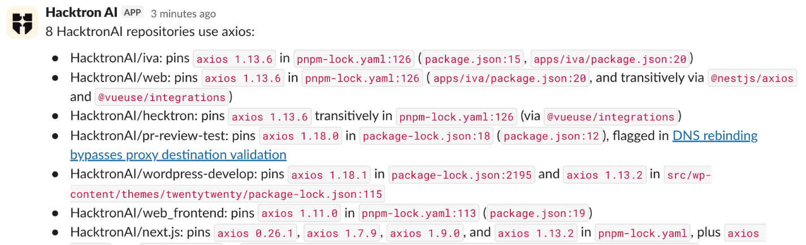

Mention **@Hacktron AI** in a Slack channel or direct message to ask security questions about your code and plans, check whether a vulnerability affects your repositories, triage findings, set up a pentest, or manage Review. Hacktron uses your Hacktron account and permissions, and replies in a thread.

You can keep going in that thread without mentioning it again. Teammates join by mentioning @Hacktron AI, and each person's requests use their own account and permissions.

## What you can ask it to do

| Task                                                                      | Example request                                                                      |
| ------------------------------------------------------------------------- | ------------------------------------------------------------------------------------ |
| [Ask a security question](#ask-security-questions)                        | We're adding file uploads to acme/web. What should we think about?                   |
| [Check a vulnerability](#check-a-vulnerability-against-your-repositories) | Does CVE-2025-29927 affect any of our repositories?                                  |
| [Look into findings](#ask-about-findings)                                 | How many critical findings are open in acme/api?                                     |
| [Triage a finding](#act-on-findings-and-scans)                            | Mark the SSRF finding in acme/api as a false positive because the URL is allowlisted |
| [Update your threat model](#keep-your-threat-model-up-to-date)            | Save the security decisions from this thread and update the threat model             |
| [Set up a pentest](#set-up-a-pentest)                                     | Pentest acme/api on main and test staging.acme.com signed in                         |
| [Manage Review](#manage-review)                                           | Turn on PR reviews for acme/api and acme/web                                         |
| [Ask how Hacktron works](#ask-how-hacktron-works)                         | How do I stop reviews of PRs into release branches?                                  |

Questions about your connected code and existing findings do not need approval. Some requests need your approval before Hacktron can continue, including opening an additional website. [When Hacktron asks you to approve](#when-hacktron-asks-you-to-approve) explains the prompts.

Your Hacktron role decides what you can do:

- Viewers can ask questions.
- Members can also have Hacktron read your code, prepare pentests, and update context documents and threat models.
- Organization admins can also start pentests, change the Review settings, and manage applications.

## Set up

<Steps>

  <Step title="Connect your workspace">

    An organization admin does this step. In Hacktron, go to **Integrations** and find **Slack** under **Notifications**. Click **Connect**, then **Connect Slack** in the panel that opens. Approve the Hacktron AI app for your workspace to install it. [Slack](/platform/communication-apps/slack) has the full steps.

    

    <Note>
    If Slack is already connected but Hacktron can't read attached archives, disconnect Slack and connect it again from **Integrations** to grant file access.
    </Note>

  </Step>
  <Step title="Link your Slack account">

    In Hacktron, open **Personal settings**, find **Connected accounts**, and click **Connect** next to **Slack**. Choose the workspace connected to your organization so Hacktron can match your Slack and Hacktron accounts. [Link your Slack identity](/code-review/integrations/slack#link-your-slack-identity) has the details.

    

  </Step>
  <Step title="Add Hacktron AI to a channel">

    In Slack, open the channel and send `/invite @Hacktron AI`, or click the channel name, open **Integrations**, and click **Add apps**. Both work for public and private channels.

    To send a direct message, find **Hacktron AI** under **Apps** in the Slack sidebar and send it a message.

  </Step>
  <Step title="Send your first request">

    Mention **@Hacktron AI** with a request. The first time, Hacktron sends you a private **Connect Hacktron** message. Click the button, sign in to Hacktron, and allow access. Hacktron waits for you to connect, then continues with your request in the thread.

  </Step>
</Steps>

## Ask security questions

Pull Hacktron into any conversation the way you would a security engineer. Ask about a feature you're planning, a design doc or PRD, how part of your app handles something like sign-in or file access, or a change you're about to ship.

Hacktron uses your connected code, threat models, context documents, pentest reports, and findings to answer. You can ask about a branch, a pull request, or the history of a change, including who changed a line and when.

A few things you might ask:

- "We're adding file uploads to acme/web. What should we think about before we build it?"
- "How does acme/api check that a user can see another team's projects?"
- "Here's our PRD for shareable report links. What are we missing security-wise?" Paste the PRD into your message or attach it.
- "Is `https://github.com/acme/api/pull/42` safe to merge?"
- "Who last changed the session middleware in acme/api, and why?"

Answers link to the relevant code, findings, and threat model. If Hacktron needs more context, it asks in the thread. Reply there to continue.

Hacktron calls something exploitable only when the code shows it, so treat its points as things to check. To confirm one, ask Hacktron to [review the pull request](/code-review/overview) or [set up a pentest](#set-up-a-pentest).

<Note>
  Hacktron can read code from repositories connected through GitHub, GitLab, and
  Azure DevOps. The first question about a branch or pull request can take a
  minute or two while Hacktron gets the code ready.
</Note>

## Check a vulnerability against your repositories

Ask about a CVE, an advisory, a vulnerable package, or this week's new vulnerabilities:

- "Does CVE-2025-29927 affect any of our repositories?"
- "Which of our repositories use lodash, and which versions?"
- "Anything published this week that affects our stack?"

Hacktron compares the advisory with dependency versions in your connected repositories, including transitive dependencies recorded in lock files. The answer identifies affected repositories, installed and fixed versions, references to the relevant files and lines, existing findings, and repositories it could not check. Hacktron only calls a vulnerability exploitable when the code shows a reachable vulnerable path.

<Note>
  For a large organization, name the repositories or languages to check first.
  Hacktron tells you which repositories it could not check.
</Note>

## When Hacktron asks you to approve

For the actions below, Hacktron posts a card describing the proposed change. Review it and click **Approve** to continue. Only the person who requested the action can use that card. Hacktron posts the result in the thread.

| Action                                                                                                   | Required role       |
| -------------------------------------------------------------------------------------------------------- | ------------------- |
| Change a finding's status or add a comment                                                               | Member or admin.    |
| Stop a scan or discard a pentest draft                                                                   | Member or admin.    |
| Review a pull request now or open a fix pull request                                                     | Member or admin.    |
| Turn Review on or off, or change Review settings                                                         | Organization admin. |
| Save or edit a context document, edit or update a threat model, or rebuild an application's threat model | Member or admin.    |
| Create an application or add repositories to it                                                          | Organization admin. |

Starting a pentest uses a separate **Start pentest** card. An organization admin reviews the scope and credit estimate, then clicks **Start pentest**. Credits are spent when the pentest starts. Preparing a draft and estimating its cost do not start the pentest.

You may also see these prompts:

| Prompt                                            | What to do                                                                                                 |
| ------------------------------------------------- | ---------------------------------------------------------------------------------------------------------- |
| **Connect Hacktron**                              | Follow the private sign-in link to connect your account. Hacktron then continues with your request.        |
| **Add login details**                             | Open the private form to provide test credentials for a pentest. Keep credentials out of the Slack thread. |
| Permission to open a website                      | Review the website and the reason Hacktron needs it, then approve access for that thread.                  |
| A choice of repositories, branches, or next steps | Choose an option in the thread so Hacktron can continue.                                                   |

## Ask about findings

Ask in your own words, for example:

- "How many critical findings are open in acme/api?"
- "Show me the high severity findings from the last pentest"
- "Which repositories have the most open findings?"

Hacktron can return counts or post finding cards that link to the details in Hacktron.

## Act on findings and scans

Ask Hacktron to change a finding's status, add a comment, stop a running scan, or discard a pentest draft. Review the proposed change and click **Approve**. Hacktron confirms the result in the thread.

Each finding card also has buttons to update its status or fix it with AI.

## Keep your threat model up to date

When a conversation settles something, ask Hacktron to save it. Your scans, pull request reviews, and later answers then take it into account. Before each change, Hacktron shows an **Approve** button that describes it.

You can ask Hacktron to:

- Save a decision, requirement, PRD, or accepted risk from the thread as a [context document](/platform/context/overview#context-documents) on the repository.
- Edit the [threat model](/platform/context/threat-models), for example to add a trust boundary. Your edits stay in place when the threat model updates later.
- Update the threat model with new context documents and triage feedback. If a repository doesn't have a threat model yet, Hacktron builds one from the code. Updates run in the background and take a few minutes.
- Create an [application](/platform/context/applications) from your repositories, add repositories to it, or rebuild its threat model. Creating an application and adding repositories need an organization admin.

## Set up a pentest

<Steps>

  <Step title="Say what to test">

    Name a connected repository, or attach a `.zip`, `.7z`, or `.tar.gz` archive of the code (up to 2 GB) to your message.

  </Step>
  <Step title="Narrow the scope">

    To pentest part of the code, name the folders in the thread, for example "only the services/payments folder". You can keep the same archive.

  </Step>
  <Step title="Add a live site">

    This step is optional. Give the URL of a deployed app if you want live testing alongside the code review, and use a staging environment where possible. Without a URL, the pentest reviews the code only.

  </Step>
  <Step title="Confirm the cost">

    Hacktron estimates the pentest and asks you to confirm.

  </Step>
  <Step title="Start it">

    Hacktron posts an approval card, and an organization admin clicks **Start pentest**. Credits are spent when the pentest starts.

  </Step>
  <Step title="Get the results">

    When the pentest finishes, Hacktron posts the results in the same thread.

  </Step>
</Steps>

### Test a site signed in

If the live site requires a login, click **Add login details** to open a private form. Enter dedicated test credentials in the form to keep them out of the Slack thread. Do not paste credentials into Slack.

Hacktron then checks that it can sign in and posts the result in the thread. If the check fails, click **Update login details** to fix them.

A pentest uses the same access mode for all its live sites: signed in or without a login. To test both, create separate pentests.

<Note>
  Signed-in testing must be enabled for your organization. If it isn't
  available, Hacktron tells you, and you can still test without signing in.
</Note>

<a id="manage-pr-reviews" />

## Manage Review

Ask Hacktron to turn Review on or off for a repository. You can also change organization settings, including whether reviews post comments, which finding severity fails the pull request check, and filters for target branches, labels, authors, and title keywords.

Anyone can ask to see the settings. Only organization admins can change them, after reviewing the change and clicking **Approve**.

## Ask how Hacktron works

Ask a product question, such as "How do I stop reviews of PRs into release branches?" Hacktron answers from the documentation and links to the relevant page. If the docs don't cover your question, it tells you.

## Follow what it's doing

Hacktron adds an eyes reaction when it picks up your message. A progress card shows what it is checking and updates as it works. The answer appears in the thread.

## Shared channels

In a Slack Connect channel, Hacktron answers people whose own workspace is connected to a Hacktron organization. When someone from another workspace mentions it, Hacktron replies with how to connect their workspace. If someone from an unconnected workspace posts in a thread, Hacktron stops answering in that thread. Mention it in a new thread to continue.

## Credits

Replies from the Slack assistant use [automation credits](/platform/automations/credits) from your organization's balance. Pentests and fixes you start from Slack cost the same as when you start them in Hacktron.

If your organization runs out of automation credits, Hacktron tells you in the thread and links to **Billing**. With auto top-up turned on, Hacktron buys more credits first.

## Limits

- Code questions use your connected repositories. For live testing, provide a deployed app URL.
- Each thread has a usage limit. When a thread reaches it, Hacktron stops and asks you to mention it in a new thread.
- A conversation ends after a week without activity, and any files attached to it are deleted. To pick it back up, mention @Hacktron AI in the thread. Hacktron reads the thread again, but you need to attach the files again.
- Hacktron can't read code from Bitbucket repositories yet.
- If Hacktron can't read an attachment, ask an organization admin to disconnect Slack and connect it again from **Integrations** to grant file access.

## Troubleshooting

| Problem                                                    | What to do                                                                                                                                      |
| ---------------------------------------------------------- | ----------------------------------------------------------------------------------------------------------------------------------------------- |
| Hacktron doesn't reply to a mention in a channel.          | Add it to the channel with `/invite @Hacktron AI`, and check that Slack is connected under **Integrations** in Hacktron.                        |
| "Hacktron couldn't find your account for this workspace."  | In Hacktron, open **Personal settings**, then **Connected accounts**, and link your Slack account, choosing the same workspace. Then try again. |
| "Your Hacktron organization is out of automation credits." | An organization owner can buy credits from **Billing** or turn on [auto top-up](/platform/automations/credits#auto-top-up).                     |
| Hacktron doesn't answer a reply in a thread.               | If someone else started the thread, mention **@Hacktron AI** in your reply. Only the person who started it can continue without a mention.      |
